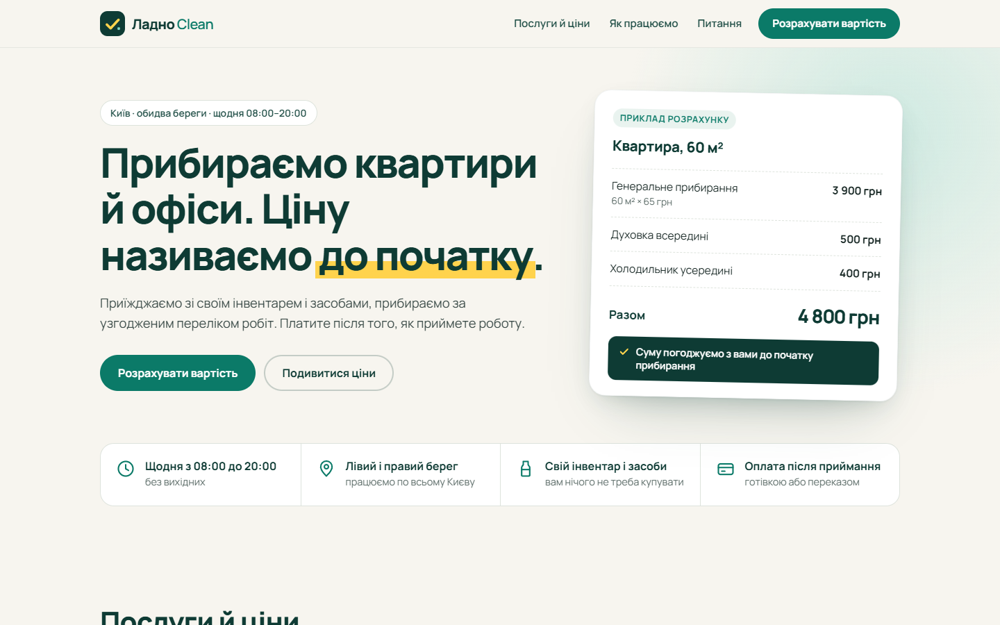
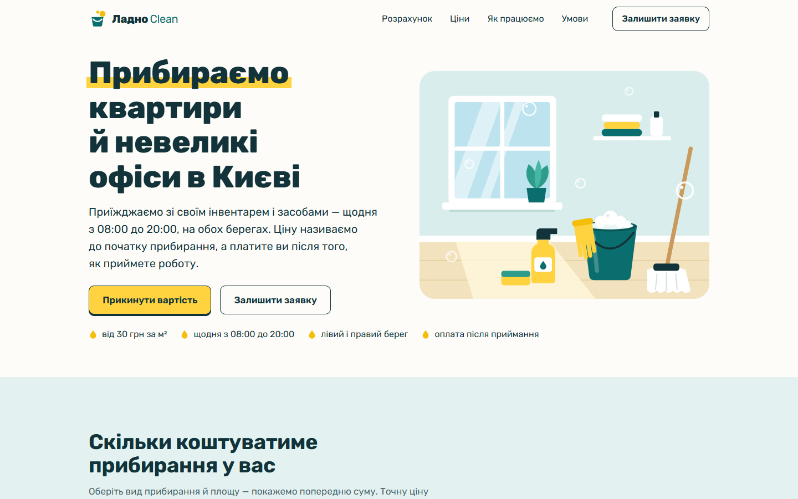

# landing

Скилл для Claude Code, с которым лендинги перестают выглядеть как вайб-код.

Я сделал его после того, как посмотрел два ролика с чеклистами «почему ваш сайт выглядит сгенерированным» и попробовал просто скормить эти списки модели. Не сработало: запрещаешь фиолетовый градиент и Inter, получаешь кремовый фон с зелёным и другой модный гротеск. Шаблон остаётся, меняется только поколение.

Поэтому скилл устроен не как список запретов, а как порядок работы: сначала понять, что продаём и кому, потом написать тексты, потом принять дизайн-решения из мира самой услуги, и только потом верстать.

## Было и стало

Одно и то же короткое ТЗ: лендинг клининговой компании в Киеве, без логотипа, цветов, фото и отзывов.

Без скилла:



Со скиллом:



Первый вариант аккуратный, но если заменить название, это может быть сайт кофейни или стоматологии. Во втором видно, чем занимается компания, ещё до того, как прочитан заголовок.

## Что делает скилл

Работа идёт в семь шагов:

1. **Бриф.** Что продаётся, кто приходит, одно целевое действие, какие факты есть в ТЗ, а каких нет.
2. **Контент раньше дизайна.** Тексты пишутся до вёрстки. Отзывы, счётчики и логотипы клиентов берутся только из ТЗ. Нет данных — нет секции.
3. **Дизайн-решения.** Три разных направления на выбор, палитра и шрифт из мира услуги, один запоминающийся элемент.
4. **Структура.** Секции идут по вопросам посетителя, а не по набору «преимущества, отзывы, тарифы».
5. **Вёрстка.** По умолчанию статический HTML и CSS без сборки, состояния кнопок и форм, мобильная ширина от 360 px.
6. **Законченность.** Favicon, картинка для превью ссылки, 404, политика конфиденциальности, никаких мёртвых ссылок.
7. **Аудит.** Скриншоты в браузере, отдельный проход по мобильной версии, сверка с чеклистом признаков.

Есть и второй режим: аудит уже готового лендинга с находками по приоритету.

## Главные идеи

- **Проверка подменой.** Мысленно меняем название на кофейню. Если дизайн подошёл без изменений, он не принят. На первом экране должна быть видна сама услуга, а мотив бренда повторяется по всей странице.
- **Три направления, и не первое.** Первое пришедшее в голову направление почти всегда шаблон. Скилл записывает три и объясняет, почему выбрал одно.
- **Продавать, а не удивлять.** Выбирается не самое оригинальное направление, а то, которому покупатель быстрее поверит.
- **Никаких выдуманных фактов.** Вместо фальшивых отзывов скилл либо убирает секцию, либо ставит заглушку `[ЗАПОЛНИТЬ: …]` и выносит её в отчёт.
- **Первый экран работает.** Заголовок «что это и для кого», главное действие и что-то наглядное видны без прокрутки.
- **Одно действие, одно название.** Кнопка везде называется одинаково и говорит, что произойдёт после нажатия.
- **Звёздочка ✦ под запретом.** Она стоит на каждой ИИ-кнопке и выдаёт страницу сильнее любого градиента.
- **Чеклист признаков в конце.** Файл `references/tells.md` используется на аудите, а не как стартовый бриф.

## Установка

```bash
git clone https://github.com/Magerko/landing-skill ~/.claude/skills/landing
```

На Windows путь будет `C:\Users\<имя>\.claude\skills\landing`. После этого скилл доступен во всех проектах.

## Как пользоваться

Просто попросите Claude Code сделать лендинг и дайте ТЗ, скилл подключится сам. Можно вызвать явно: `/landing`.

Примеры запросов:

- «Сделай лендинг по этому ТЗ» и текст или файл с заданием.
- «Проверь мой лендинг, он выглядит как у всех».
- «Нужен быстрый черновик лендинга» — в этом случае шаг с юридическими страницами и 404 пропускается.

Если вы на связи, скилл сначала покажет концепцию в пять-семь строк и дождётся ответа. Это самый дешёвый момент, чтобы что-то поменять.

## Как я это проверял

Я запускал двух агентов на одном и том же ТЗ: один собирал лендинг как обычно, второй со скиллом. После каждого сравнения правил скилл и запускал снова. Всего было пять прогонов на двух продуктах.

Что выяснилось:

- На подробном ТЗ, где уже заданы цвета, шрифт и тексты, разницы почти нет. Скилл нужен там, где исполнитель решает сам.
- На коротком ТЗ разница видна с первого экрана.
- Первая версия скилла давала оригинальные, но сухие страницы, которые продавали хуже обычных. Отсюда правило «выбирать то, чему поверит покупатель».
- Два аккуратных варианта подряд не говорили, что это клининг. Отсюда проверка подменой и обязательная иллюстрация услуги.
- Модель и без скилла не выдумывала отзывы. Правило про факты я оставил как страховку.

## Ограничения

- Сборка со скиллом идёт примерно вдвое дольше и тратит в полтора-два раза больше токенов.
- Тестов мало, по одному прогону на вариант, так что это рабочий инструмент, а не доказанная методика.
- Скилл заточен под лендинги. Для интерфейсов приложений нужен другой порядок работы.
- Политика конфиденциальности получается черновиком с заглушками. Её должен посмотреть юрист.

## Что внутри

```
SKILL.md              порядок работы, семь шагов
references/tells.md   чеклист признаков шаблонного лендинга
examples/             скриншоты для сравнения
LICENSE               лицензия MIT
```

## Лицензия

MIT. Пользуйтесь, меняйте и распространяйте свободно.
